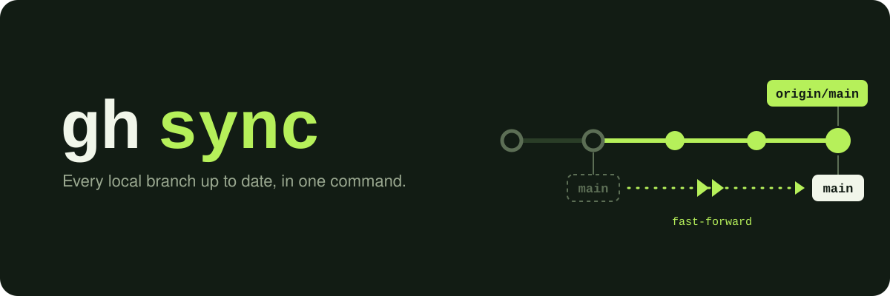

<p align="center"></p>

# gh-sync

[English](README.md) | 日本語

[](https://github.com/him0/gh-sync/actions/workflows/ci.yml)
[](https://github.com/him0/gh-sync/releases/latest)
[](LICENSE)

すべてのローカルブランチをコマンド 1 つでリモートの最新状態に追従させ、リモートでマージ・削除済みのブランチを片付ける [GitHub CLI](https://cli.github.com/) 拡張です。

[`hub sync`](https://hub.github.com/hub-sync.1.html) を独自に再実装したもので、[hub](https://github.com/mislav/hub) から gh に移行した人に向いています。

```console
$ gh sync
Updated branch main (was 3f2a1bc).
Updated branch feature/login (was 9d04e7a).
Deleted branch fix/typo (was c81b2d5, merged via #42).
warning: 'wip/experiment' has 2 commits not in 'origin/wip/experiment'; not updated
```

## インストール

```bash
gh extension install him0/gh-sync
```

[GitHub CLI](https://cli.github.com/) 2.0 以降と Git 2.23 以降が必要です。macOS・Linux・Windows・FreeBSD 向けにビルド済みバイナリを配布しているため、Go は不要です。

アップグレードは `gh extension upgrade sync`、バージョンを指定してインストールするには `gh extension install him0/gh-sync --pin v0.5.0` を実行します。

## 使い方

git リポジトリの中で `gh sync` を実行します。

### 動作

1. **main remote を決めます。** `--remote` で指定した remote、無ければ `upstream`、`github`、`origin` のうち最初に見つかったもの、どれも無ければ最初の remote を使います。fork に `upstream` を追加している場合は、親リポジトリと同期します。
2. `git fetch --prune` で **その remote を fetch します。** ローカルブランチが追跡しているほかの remote(fork の `origin` など)も一緒に fetch します。fetch できなかった remote を追跡するブランチは、警告を出してスキップします。
3. [除外](#ブランチの除外)したものを除く **すべてのローカルブランチを** upstream と、upstream が無ければ main remote 上の同名のブランチと比較します。

| ローカルブランチ | gh-sync の動作 |
| --- | --- |
| 遅れている | fast-forward する |
| 先行している、または分岐している | 警告を出して残す |
| upstream が削除済みで、[マージ済み](#マージ済みのブランチ) | 削除する |
| upstream が削除済みだが、マージされていない | 警告を出して残す |
| 最新、または remote に対応するブランチが無い | 何もしない |

### マージ済みのブランチ

upstream が削除されたブランチは、次のどちらかに当てはまればマージ済みとみなします。

- 全コミットが main remote のデフォルトブランチに含まれる。
- 先頭が、マージ済み pull request の head か、そのコミットのいずれかと一致する。squash や rebase でのマージと、pull request より遅れているブランチ(GitHub の「Update branch」や、ほかの場所からの push があった場合)がこれに当たります。どの pull request かはメッセージに出ます: `Deleted branch <name> (was <sha>, merged via #<number>).`

マージ済み pull request の head の上にコミットを追加したブランチは残します。

pull request は `gh api graphql` で確認します。確認するのは各 pull request の最後の 100 コミットだけで、追加の fetch はしません。確認できなかった場合、その結果が必要なブランチは残します。[トラブルシューティング](#トラブルシューティング)を参照してください。

### 安全性

- merge、rebase、強制更新、push は一切しません。ローカルにしか無いコミットを持つブランチは必ず残ります。
- 削除されうるのは、upstream を git が prune した(`[gone]`)ブランチだけです。upstream を一度も設定していないブランチや、upstream が fetch refspec の対象外のブランチ(single-branch クローン、`gh pr checkout` による `refs/pull/<N>/head`)は削除しません。
- 削除するブランチをチェックアウト中の場合は、先にデフォルトブランチへ切り替えます。ローカルに無ければ main remote から作成します。
- [別の worktree](#別の-worktree) でチェックアウトされているブランチは更新しません。削除するのは `--remove-worktrees` を付けたときだけです。
- 更新するのは**ローカル**のブランチだけです。fork を `upstream` と同期したあと、fork も更新するには push してください(例: `git push origin main`)。

## オプション

| オプション | 説明 |
| --- | --- |
| `--dry-run` | ブランチも worktree も変更せずに `Would update branch ...` / `Would delete branch ...` / `Would remove worktree ...` を表示する。fetch は実行する |
| `--verbose` | 変更や検索を行う git・`gh` コマンドと、スキップしたブランチの note も stderr に表示する |
| `--remote=NAME` | `NAME` を main remote として使う |
| `--exclude=GLOB` | `GLOB` に一致するブランチには触れない。複数回指定可。[ブランチの除外](#ブランチの除外)を参照 |
| `--remove-worktrees` | 削除するブランチの worktree を削除してから、ブランチを削除する。ignore されているファイルも消える。[worktree の削除](#worktree-の削除)を参照 |
| `--color=WHEN` | `auto`(デフォルト)、`always`、`never` |
| `--version` | バージョンを表示する |
| `--help` | 使い方を表示する |

gh-sync は位置引数を取りません。`gh sync dry-run`(`--` の付け忘れ)は同期せずにエラーになります。

### ブランチの除外

除外したブランチは fast-forward も削除もされません。パターンは `--exclude` と git config の `gh-sync.exclude` から読み込み、すべてを適用します。

```sh
git config --add gh-sync.exclude 'wip/*'   # --global ですべてのリポジトリに適用
gh sync --exclude='wip/*' --exclude=tmp
```

パターンはブランチ名全体に対して Go の [`path.Match`](https://pkg.go.dev/path#Match) で照合するため、`*` は `/` に一致しません。`wip/*` は `wip/foo` に一致しますが、`wip/foo/bar` には一致しません。

### 色と出力

- **stdout**: ブランチの更新・削除・切り替えと、worktree の削除。
- **stderr**: 警告、hint、note、エラー、`--verbose` の出力。端末のときは fetch の進捗も表示します。更新・削除したブランチが無く、警告も出ず、別の worktree が理由でスキップしたブランチも無ければ、`Already up to date.` も表示します。
- **終了ステータス**: 実行できなかったときや、更新・削除・fetch に失敗したときは `1`。それ以外は、警告や note を出してスキップした場合を含めて `0` です。
- **色**: 更新したブランチは緑、削除したブランチは赤、警告は黄、エラーは太字の赤です。`--color=auto` では stdout と stderr をそれぞれ端末のときだけ色付けし、空でない [`NO_COLOR`](https://no-color.org) があれば色を付けません。

## 別の worktree

別の worktree でチェックアウトされているブランチは、git が移動も削除も拒否します。gh-sync はそのブランチをスキップし、最後にまとめて報告します。

```console
warning: 2 merged branches are still checked out in other worktrees; not deleted:
  feature/a      .claude/worktrees/eager-wiggling-moonbeam
  feature/long   /home/me/elsewhere/wt
hint: remove a worktree with `git worktree remove <path>`, or run `gh sync --remove-worktrees` to remove the clean ones
note: 3 branches checked out in other worktrees are behind their upstream; not updated
```

- warning には、削除するはずだったブランチが並びます。main worktree の中にある worktree は main worktree からの相対パスで、それ以外は絶対パスで表示します。
- note は、fast-forward するはずだったブランチの数です。`--verbose` を付けると同じ形式の一覧も表示します。更新するには、その worktree で `git pull --ff-only` を実行してください。

### worktree の削除

`--remove-worktrees` を付けるか、`git config gh-sync.removeWorktrees true` を設定すると、削除するブランチの worktree を `git worktree remove` で削除してから、ブランチを削除します。`--force` は使いません。

```console
Removed worktree .claude/worktrees/eager-wiggling-moonbeam.
Deleted branch feature/a (was 1a2b3c4, merged via #12).
```

デフォルトで無効なのは、次の二つを防げないためです。

- **ignore されているファイルは確認なしに削除されます。** git が拒否するのは変更済みまたは未追跡のファイルがある場合だけなので、worktree にある ignore 対象の `.env` やビルド成果物は失われます。
- **その worktree でシェルやエージェントのセッションが動いているかどうかは、gh-sync には分かりません。** 動いていれば、作業ディレクトリが無くなります。

git が削除を拒否した worktree は、ブランチとともに残します。終了ステータスは `0` のままです。

```console
warning: 'feature/b' is checked out in .claude/worktrees/calm-river, which has modified or untracked files; not deleted
warning: 'feature/c' is checked out in /home/me/elsewhere/wt, which is locked; not deleted
```

それ以外の理由(submodule を含む worktree など)で拒否された場合は、`..., which couldn't be removed: <git のメッセージ>; not deleted` と表示します。

- フラグは設定より優先します。`--remove-worktrees=false` で、その実行だけ無効にできます。
- 遅れているだけのブランチの worktree と main worktree は削除しません。
- `--dry-run` では、`git status` とロックの有無をもとに `Would remove worktree <path>.` または同じ警告を表示します。submodule など、予測できない拒否もあります。

## トラブルシューティング

**`could not determine default branch`**
main remote に使える `HEAD`、`main`、`master` がありません。`git remote set-head <remote> --auto` で設定してください。

**`warning: couldn't fast-forward '<name>'`**
チェックアウト中のブランチのローカルの変更が上書きされてしまいます。commit か stash をしてから、もう一度 `gh sync` を実行してください。

**`warning: '<name>' upstream config is broken; skipping`**
`branch.<name>.merge` が無いか、不正です。`git branch --set-upstream-to=<remote>/<branch> <name>` で直してください。

**`warning: couldn't look up merged pull requests: <reason>`**
`gh` が未認証か、remote が GitHub 上に無いか、API が失敗したか 30 秒以内に応答しませんでした。確認できるようになるまで、コミットがデフォルトブランチに含まれないブランチは `... and pull requests couldn't be looked up; not deleted` と警告して残します。`gh auth status` を確認してください。`~/.ssh/config` のホストエイリアスや `ssh.github.com` は `ssh -G` で解決します。

バグを報告するときは、`gh sync --version` と `gh sync --verbose` の出力を添えてください。

## 開発

ツールのバージョンとタスクは [mise](https://mise.jdx.dev/) で管理しています。

```bash
mise run build   # ./gh-sync をビルドする
mise run test    # go test ./...
mise run lint    # go vet、gofmt のチェック、golangci-lint
```

`v*` タグを push するとリリースが公開されます。開発上の決まりは [CLAUDE.md](CLAUDE.md) を参照してください。

## ライセンス

[MIT](LICENSE)
