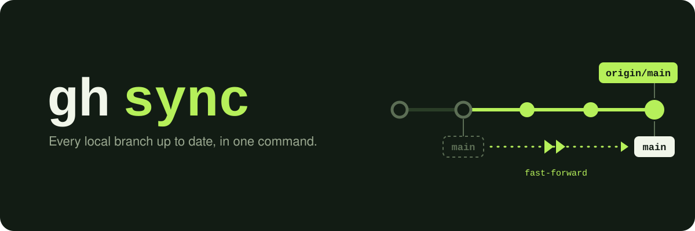

<p align="center"></p>

# gh-sync

[English](README.md) | 日本語

[](https://github.com/him0/gh-sync/actions/workflows/ci.yml)
[](https://github.com/him0/gh-sync/releases/latest)
[](LICENSE)

すべてのローカルブランチをコマンド 1 つでリモートの最新状態に追従させ、リモートでマージ・削除済みのブランチを片付ける [GitHub CLI](https://cli.github.com/) 拡張です。

[`hub sync`](https://hub.github.com/hub-sync.1.html) を単体の拡張として移植したもので、hub から gh に移行した人に向いています。

```console
$ gh sync
Updated branch main (was 3f2a1bc).
Updated branch feature/login (was 9d04e7a).
Deleted branch fix/typo (was c81b2d5).
warning: 'wip/experiment' seems to contain unpushed commits
```

## インストール

```bash
gh extension install him0/gh-sync
```

macOS・Linux・Windows・FreeBSD 向けにビルド済みバイナリを配布しているため、Go は不要です。

```bash
# 最新リリースにアップグレードする
gh extension upgrade sync

# バージョンを指定してインストールする
gh extension install him0/gh-sync --pin v0.5.0
```

## 使い方

git リポジトリの中で実行します。

```bash
gh sync
```

### 動作

1. **main remote を決めます。** `--remote` で指定した remote を使います。指定が無ければ `upstream`、`github`、`origin` の順に探して最初に見つかったものを使い、どれも無ければ git が最初に列挙する remote を使います。通常の clone では `origin` です。fork に `upstream` を追加している場合は、代わりに親リポジトリと同期します。
2. `git fetch --prune` で **その remote を fetch します。** stderr が端末のときは、fetch の進捗がそこに表示されます。
3. **すべてのローカルブランチを順に調べ**、main remote 上の対応するブランチと比較します。ブランチがその remote を追跡していれば設定済みの upstream と、そうでなければ同名のブランチと比較します。

| ローカルブランチの状態 | 動作 |
| --- | --- |
| リモートブランチより遅れている | fast-forward する: `Updated branch <name> (was <sha>).` |
| 最新 | 何もしない |
| リモートブランチに無いコミットがある(先行または分岐) | 触らない: `warning: '<name>' seems to contain unpushed commits` |
| upstream ブランチが削除済みで、全コミットがリモートのデフォルトブランチに含まれる | 削除する: `Deleted branch <name> (was <sha>).` |
| upstream ブランチが削除済みで、リモートのデフォルトブランチに無いコミットがあるが、デフォルトブランチにマージ済みの pull request の head がブランチの先頭と一致する(squash や rebase でのマージ) | 削除する: `Deleted branch <name> (was <sha>, merged via #<number>).` |
| upstream ブランチが削除済みで、リモートのデフォルトブランチに無いコミットがあり、head がブランチの先頭と一致する、デフォルトブランチにマージ済みの pull request も無い | 触らない: `warning: '<name>' was deleted on <remote>, but appears not merged into '<default>'` |
| main remote に対応するブランチが無い | 何もしない |

### 安全性

gh-sync が行うのは、ブランチを前に進めることと、完全にマージ済みのブランチを削除することだけです。

- merge、rebase、強制更新、push は一切しません。ローカルにしか無いコミットを持つブランチは必ずそのまま残ります。
- ブランチを削除するのは、main remote 上のブランチを追跡していて、そのブランチが消えており、かつリモートのデフォルトブランチに無いコミットを持たないか、デフォルトブランチにマージ済みの pull request の head コミットがローカルブランチの先頭と完全に一致する場合だけです。upstream を一度も設定していないブランチは削除しません。
- こうしたブランチは、ほかのブランチの処理が終わったあとに、main remote のリポジトリに対する `gh api graphql` のリクエスト(50 本ごとに 1 回)でまとめて確認します。そのため、これらのメッセージは最後に出力されます。確認できない場合(`gh` が未認証、GitHub 以外の remote、API エラー、30 秒以内に応答が無い)は「appears not merged」の警告を出してブランチを残します。理由は `--verbose` で表示されます。pull request のマージ後にコミットを追加したブランチも残します。
- 削除対象のブランチをチェックアウト中の場合は、先にデフォルトブランチへ切り替え、`Switched to branch ...` と表示します。ローカルにデフォルトブランチが無い場合は、main remote のデフォルトブランチを追跡するブランチとして作成します。
- 別の worktree でチェックアウトされているブランチは動かしません。

知っておくとよい点:

- gh-sync が更新するのは**ローカル**のブランチだけです。fork を `upstream` と同期した場合、GitHub 上の fork も更新するには、あとで push してください(例: `git push origin main`)。

## オプション

| オプション | 説明 |
| --- | --- |
| `--verbose` | 変更を伴う git コマンドと、マージ済み pull request を検索する `gh` コマンドを、`$ git ...` / `$ gh ...` の形式で stderr に表示する(hub の `HUB_VERBOSE=1` 相当) |
| `--dry-run` | 更新・削除されるブランチを表示する(`Would update branch ...`、`Would delete branch ...`。チェックアウト中のブランチが削除される場合は、その前に `Would switch to branch ...`)だけで、ローカルブランチは変更しない。fetch は実行する |
| `--color=WHEN` | 出力に色を付ける: `auto`(デフォルト)、`always`、`never` |
| `--remote=NAME` | main remote を自動で選ばず、`NAME` を使う。その名前の remote が無ければエラーになる |
| `--version` | gh-sync のバージョンを表示して終了する |
| `--help` | 使い方を stdout に表示する |

gh-sync は位置引数を取りません。`gh sync dry-run`(`--` の付け忘れ)や `gh sync foo --dry-run` のようにオプション以外の引数を渡すと、`fatal: unexpected argument: ...` と使い方を表示してエラーになり、同期は行いません。

### 色

更新したブランチは緑、削除したブランチは赤、警告は黄、エラーは太字の赤で表示します。

`--color=auto` では stdout と stderr を別々に判定し、それぞれ端末(Git Bash の MSYS2 / Cygwin 端末を含む)に接続されているときだけ色を付けます。そのため `gh sync | grep Updated` ではエスケープシーケンスが出力されず、端末に出る警告には色が付いたままになります。

環境変数 [`NO_COLOR`](https://no-color.org) に空でない値を設定すると、`auto` では色が無効になります(空の `NO_COLOR=` は無視します)。`--color=always` はこれより優先されます。

### 出力と終了ステータス

- `Updated branch ...`、`Switched to branch ...`、`Deleted branch ...`(`--dry-run` では `Would update branch ...`、`Would switch to branch ...`、`Would delete branch ...`)は **stdout** に出力されます。
- 警告、エラー、`--verbose` のログ、git の fetch の進捗は **stderr** に出力されます。失敗した git コマンドのメッセージは、警告やエラーの中に 1 回だけ表示されます。
- 終了ステータスは、成功時(警告を出してブランチをスキップした場合を含む)が `0`、実行できなかったとき(想定外の引数がある、git リポジトリではない、remote が無い、fetch に失敗した)や更新・削除に失敗したときが `1` です。

```console
$ gh sync --verbose
$ git fetch --prune --quiet --progress origin
$ git merge --ff-only --quiet refs/remotes/origin/main
Updated branch main (was 3f2a1bc).
```

## トラブルシューティング

**`could not determine default branch`**
fetch した後も、main remote に使える `HEAD` の参照が無く(参照が無いか、もう存在しないブランチを指している)、`main` も `master` もありません。次のコマンドで設定してください。

```bash
git remote set-head <remote> --auto
```

**`warning: couldn't fast-forward '<name>'`**
チェックアウト中のブランチでローカルの変更が上書きされてしまうか、別の worktree でチェックアウトされています。変更を commit または stash してから、もう一度 `gh sync` を実行してください。

**`warning: '<name>' upstream config is broken; skipping`**
`branch.<name>.merge` が無いか、不正です。次のコマンドで直してください。

```bash
git branch --set-upstream-to=<remote>/<branch> <name>
```

**意図しない remote が使われる**
`--remote` を指定しない場合の優先順位は `upstream`、`github`、`origin` です。使う remote を `--remote` で指定するか(`gh sync --remote=fork`)、これに合わせて remote の名前を変更してください(`git remote rename <old> upstream`)。

バグを報告するときは、`gh sync --version` と `gh sync --verbose` の出力を添えてください。

## 必要なもの

- [GitHub CLI](https://cli.github.com/) 2.0 以降
- Git

## 開発

ツールのバージョンとタスクは [mise](https://mise.jdx.dev/) で管理しています。Go のバージョンは `go.mod` から読み込み、golangci-lint は CI と同じバージョンに固定しています。

```bash
mise run build   # ./gh-sync をビルドする
mise run test    # go test ./...
mise run lint    # go vet、gofmt のチェック、golangci-lint

./gh-sync --verbose        # ローカルビルドを直接実行する
gh extension install .     # またはチェックアウトを `gh sync` としてインストールする
```

`v*` タグを push すると、全プラットフォーム向けのバイナリがビルドされ、リリースが公開されます。コードや設定ファイルからは読み取れない開発上の決まり（README の両言語版の更新、golangci-lint のバージョン固定、workflow のロックファイルの更新）は [CLAUDE.md](CLAUDE.md) を参照してください。

## 謝辞

[hub](https://github.com/mislav/hub) の `sync` コマンドに着想を得て、GitHub CLI 向けに独自に再実装したものです。

## ライセンス

[MIT](LICENSE)
