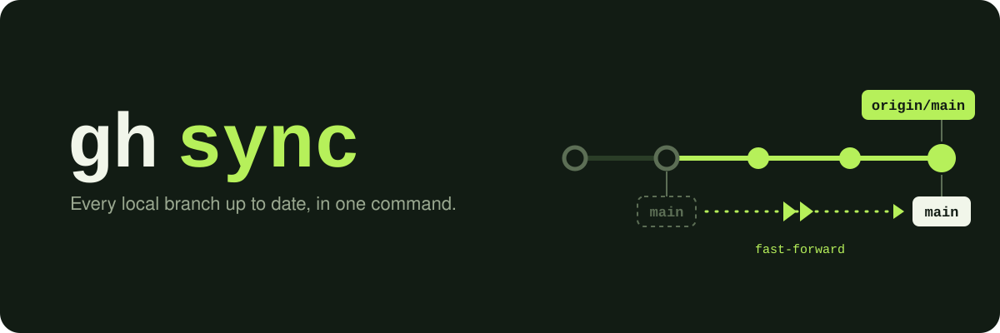

<p align="center"></p>

# gh-sync

English | [日本語](README.ja.md)

[](https://github.com/him0/gh-sync/actions/workflows/ci.yml)
[](https://github.com/him0/gh-sync/releases/latest)
[](LICENSE)

A [GitHub CLI](https://cli.github.com/) extension that brings every local branch up to date with its remote in one command, and cleans up the branches that were merged and deleted there.

It is a standalone port of [`hub sync`](https://hub.github.com/hub-sync.1.html) for people who moved from hub to gh.

```console
$ gh sync
Updated branch main (was 3f2a1bc).
Updated branch feature/login (was 9d04e7a).
Deleted branch fix/typo (was c81b2d5).
warning: 'wip/experiment' seems to contain unpushed commits
```

## Installation

```bash
gh extension install him0/gh-sync
```

Precompiled binaries are published for macOS, Linux, Windows and FreeBSD, so Go is not required.

```bash
# Upgrade to the latest release
gh extension upgrade sync

# Install a specific version
gh extension install him0/gh-sync --pin v0.5.0
```

## Usage

Run it anywhere inside a git repository:

```bash
gh sync
```

### What it does

1. **Picks the main remote**: the one given with `--remote`, otherwise the first of `upstream`, `github` and `origin` that exists, otherwise the first remote. In a fork with an `upstream` remote, your branches are synced with the parent repository.
2. **Fetches it** with `git fetch --prune`, together with every other remote a local branch tracks (such as your fork's `origin`). If one of those can't be fetched, the branches tracking it are skipped with a warning.
3. **Checks every local branch**, except [excluded](#excluding-branches) ones, against its upstream, or against the same-named branch on the main remote when it has none. Merges are always checked against the main remote's default branch.

| Local branch | Action |
| --- | --- |
| Behind | Fast-forwarded: `Updated branch <name> (was <sha>).` |
| Ahead or diverged | Kept: `warning: '<name>' seems to contain unpushed commits` |
| Upstream deleted, all commits in the default branch | Deleted: `Deleted branch <name> (was <sha>).` |
| Upstream deleted, tip is the head of a merged pull request (squash or rebase merge) | Deleted: `Deleted branch <name> (was <sha>, merged via #<number>).` |
| Upstream deleted, otherwise | Kept: `warning: '<name>' was deleted on <remote>, but appears not merged into '<default>'` |
| Up to date, or no counterpart on the remote | Nothing |

### Safety

- gh-sync never merges, rebases, force-updates or pushes. A branch with local-only commits is always kept.
- Only a branch whose upstream git pruned (`[gone]`) can be deleted. Branches that never had an upstream, or whose upstream is outside the fetch refspec (a single-branch clone, `refs/pull/<N>/head` from `gh pr checkout`), are never deleted.
- Merged pull requests are looked up with `gh api graphql`, one request per 50 branches. When that fails (`gh` not authenticated, a remote not on GitHub, an API error, a 30-second timeout), the branch is kept; `--verbose` shows why. SSH host aliases from `~/.ssh/config` and `ssh.github.com` are resolved with `ssh -G`.
- If the branch to delete is checked out, gh-sync first switches to the default branch (`Switched to branch ...`), creating it from the main remote if needed.
- A branch checked out in another worktree is skipped with a warning.

gh-sync updates **local** branches only. After syncing a fork against `upstream`, push to update the fork too (e.g. `git push origin main`).

## Options

| Option | Description |
| --- | --- |
| `--verbose` | Print the git and `gh` commands that change or look something up to stderr, plus notes on skipped branches |
| `--dry-run` | Print `Would update branch ...` / `Would delete branch ...` without changing any branch. The fetch still runs |
| `--color=WHEN` | `auto` (default), `always` or `never` |
| `--remote=NAME` | Use `NAME` as the main remote |
| `--exclude=GLOB` | Leave branches matching `GLOB` alone. Repeatable. See [Excluding branches](#excluding-branches) |
| `--version` | Print the version |
| `--help` | Print usage |

gh-sync takes no positional arguments: `gh sync dry-run` (missing `--`) is rejected instead of running a sync.

### Excluding branches

Excluded branches are never fast-forwarded or deleted. Patterns come from `--exclude` and from the `gh-sync.exclude` git config key, and all of them apply:

```sh
git config --add gh-sync.exclude 'wip/*'   # add --global for every repository
gh sync --exclude='wip/*' --exclude=tmp
```

Patterns are matched against the whole branch name with Go's [`path.Match`](https://pkg.go.dev/path#Match), so `*` does not match `/`: `wip/*` matches `wip/foo` but not `wip/foo/bar`.

### Color and output

Updated branches are green, deleted ones red, warnings yellow and errors bold red. With `--color=auto`, stdout and stderr are each colorized only when they are a terminal, and a non-empty [`NO_COLOR`](https://no-color.org) disables color.

Branch updates, deletions and switches go to stdout; warnings, errors, `--verbose` output and fetch progress go to stderr. The exit status is `1` when gh-sync could not run or an update, deletion or fetch failed, and `0` otherwise, including when branches were skipped with a warning.

## Troubleshooting

**`could not determine default branch`**
The main remote has no usable `HEAD`, `main` or `master`. Set it with `git remote set-head <remote> --auto`.

**`warning: couldn't fast-forward '<name>'`**
Local changes in the checked-out branch would be overwritten. Commit or stash them and run `gh sync` again.

**`warning: '<name>' upstream config is broken; skipping`**
`branch.<name>.merge` is missing or invalid. Fix it with `git branch --set-upstream-to=<remote>/<branch> <name>`.

When reporting a bug, please include the output of `gh sync --version` and `gh sync --verbose`.

## Requirements

- [GitHub CLI](https://cli.github.com/) 2.0 or later
- Git 2.23 or later

## Development

Tool versions and tasks are managed with [mise](https://mise.jdx.dev/).

```bash
mise run build   # build ./gh-sync
mise run test    # go test ./...
mise run lint    # go vet + gofmt check + golangci-lint
```

Pushing a `v*` tag publishes a release. See [CLAUDE.md](CLAUDE.md) for the contribution rules.

## Acknowledgments

Inspired by the `sync` command of [hub](https://github.com/mislav/hub), which this extension reimplements on its own for the GitHub CLI.

## License

[MIT](LICENSE)
